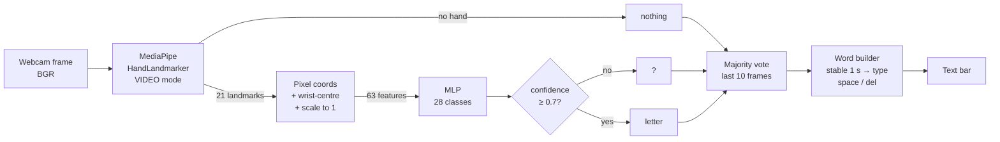

# ASL Alphabet Recognizer

Real-time American Sign Language fingerspelling from a normal webcam. MediaPipe finds 21 hand landmarks, a small neural network classifies the hand shape, and a word builder turns stable letters into text.

## Problem

Fingerspelling is how ASL users spell names, places and words with no sign of their own. Most hearing people can't read it, and interpreters aren't always available. The goal: recognize the static ASL alphabet live, on a laptop CPU, with no special hardware, and be honest about where it fails.

Dataset: [Kaggle ASL Alphabet](https://www.kaggle.com/datasets/grassknoted/asl-alphabet). 200×200 photos, 29 classes (A–Z, `space`, `del`, `nothing`), 3000 images per class.

## Approach

Two stages instead of one end-to-end image model:

1. **Hand landmarks.** MediaPipe HandLandmarker returns 21 3D points per hand.
2. **Normalization.** Subtract the wrist and divide by the largest wrist-to-point distance. The result is 63 numbers describing only the *shape* of the hand.
3. **Classifier.** An MLP (63 → 256 → 128 → 64 → 28, BatchNorm + Dropout, 60.7k parameters) predicts one of 28 classes: A–Z, `space`, `del`.
4. **`nothing` is a rule, not a class.** No hand detected means "nothing". The classifier never sees empty images, because a no-hand frame has no landmarks to classify.

A small CNN on raw 64×64 pixels (97.5k parameters) is the baseline.

## Architecture



Training uses the same path. `src/utils.py` (`detect_hand`) is the only place where a detection becomes features, and both `extract_landmarks.py` and `live_demo.py` call it. If training and live preprocessing differ, accuracy drops without any error message, so there is one implementation only.

## Why landmarks?

- **Background and lighting don't reach the classifier.** It only sees 63 coordinates, so it can't learn "this background means A".
- **Position and scale invariant.** Wrist-centering and scaling make a sign at the edge of the frame, close or far, produce the same vector.
- **Small and fast.** The classifier is 0.78 MB and runs in ~6 ms on CPU.
- **Privacy.** After detection only coordinates are processed, not faces or rooms.
- **Rotation is deliberately kept.** Some letters differ mainly by orientation (H vs U, G vs Q).

## Results

### Classifier and pipeline vs CNN

| Metric | Landmark MLP | Baseline CNN |
|---|---|---|
| Test-split accuracy | **98.5%** \* | 91.1% |
| Test-split macro F1 | 0.984 \* | 0.909 |
| End-to-end accuracy, held-out raw images (n=1400) | 74.4% | **89.1%** |
| Accuracy when a hand is detected (held-out) | 99.0% | n/a |
| Hand detection rate (held-out) | 75.1% | n/a |
| Parameters | 60,700 | 97,532 |
| Inference per image (median, CPU) | 34 ms (MediaPipe + MLP) | 18 ms |

\* Only images where MediaPipe found a hand. The end-to-end row counts every missed detection as an error.

**How to read this:** when the hand is found, the MLP is almost always right (99.0%). Its end-to-end score is limited by detection (75%), not by classification. The CNN scores higher end-to-end on this dataset, but the held-out images are near-duplicate frames of the same signer, background and lighting it trained on, so that number is optimistic. The lighting test shows what happens when conditions change.

Details: [reports/comparison.md](reports/comparison.md), [classification_report_mlp.txt](reports/classification_report_mlp.txt), [confusion_matrix.png](reports/confusion_matrix.png).

### Lighting robustness (held-out images, end-to-end)

| Condition | MLP accuracy | MLP detection rate | MLP accuracy when detected | CNN accuracy |
|---|---|---|---|---|
| Original | 76.4% | 77.1% | 99.1% | 89.7% |
| Dark (×0.35) | 53.5% | 56.7% | 94.3% | 12.9% |
| Bright (+100) | 71.1% | 74.3% | 95.7% | 12.8% |
| Low contrast | 59.0% | 61.9% | 95.4% | 7.7% |

The CNN collapses to near-chance (1/28 ≈ 3.6%) under every lighting change. It had learned the dataset's lighting. The landmark pipeline degrades gracefully: it mostly loses *detections*, and when it does find the hand it stays at 94–96%. See [lighting_robustness.png](reports/lighting_robustness.png), [lighting_examples.png](reports/lighting_examples.png).

### Detection experiments

About 24% of Kaggle images have no hand detected (worst: N 57%, space 48%, M 46%; see `data/processed/extraction_stats.csv`). Tried to fix it on the same 50 images per class:

| Setting | Detection rate | Change | False hands on "nothing" (of 50) |
|---|---|---|---|
| Baseline (no pad, conf 0.5) | 76.0% | — | 0 |
| Pad 10% white border | 76.2% | +0.2 | 1 |
| Pad 30% | 68.9% | −7.1 | 0 |
| Upscale to 400 px | 73.9% | −2.1 | 0 |
| Confidence 0.3 | 79.9% | +3.9 | 0 |
| Upscale 400 + conf 0.3 | 77.2% | +1.2 | 0 |

The rule was "adopt only if it gains more than +5 points with zero false hands". Nothing passed, so the baseline was kept. Padding shrinks the hand in what MediaPipe sees, and it changed the features of the same image more than two different images of the same letter differ. So any preprocessing change must be applied identically in training and live. Live, the demo exposes `--min-detection-confidence`. `src/false_hand_test.py` measures whether 0.3 causes false hands on your own background ([reports/false_hand_test.md](reports/false_hand_test.md) after you run it). Full write-up: [reports/detection_experiments.md](reports/detection_experiments.md).

## Limitations

- **J and Z are motion signs.** The dataset (and this model) uses a single frame, so J and Z are recognized by their end pose only. Real J/Z need a sequence model.
- **One hand only.** `num_hands=1`. Two-handed signs and full ASL (grammar, facial expressions) are out of scope. This is fingerspelling only.
- **One signer, one background.** All Kaggle images come from one person in one setting, as consecutive video frames. Test splits are near-duplicates of training data, so 98.5% is an upper bound. Other hand sizes, skin tones and signing styles are untested.
- **~24% detection misses on the dataset.** The small, dark 200×200 images are hard for MediaPipe, especially closed-fist letters (M, N, S-like shapes) where fingers hide the thumb. A missed detection becomes "nothing".
- **Confusable pairs.** M/N (thumb hidden under 2 vs 3 fingers), R/U (crossing is tiny in 2D), G/H, C/space.
- **Handedness.** Rotation and mirroring aren't normalized. If you sign with the other hand than the dataset signer, use `--flip-input`.

## Future work

- Collect webcam data from several signers, backgrounds and both hands. Retrain and evaluate per signer (leave-one-signer-out).
- Sequence model (LSTM/Transformer over landmark sequences) for J, Z and dynamic signs.
- Mirror augmentation for left-handed signers. Engineered features such as finger angles and fingertip distances for M/N and R/U.
- Make detection more robust: train on frames where MediaPipe fails, or use a hand detector fine-tuned on low-light images.
- Dictionary-based autocorrect on the word builder. Text-to-speech output.
- Export to TFLite and run on a phone.

## How to run

Requires Python 3.13 on Windows (tested). From the project folder:

```powershell
python -m venv venv
venv\Scripts\activate
pip install -r requirements.txt
```

Download `hand_landmarker.task` into `models/` from the URL in `src/utils.py` (`MODEL_URL`).

**Live demo** (needs `models/asl_landmark_model.keras` and `models/label_encoder.joblib`):

```powershell
python src/live_demo.py
python src/live_demo.py --min-detection-confidence 0.3 --camera 1
```

| Key | Action |
|---|---|
| `q` | quit |
| `c` | clear text |
| `s` | save a screenshot to `reports/` |

Hold a letter steady for about 1 s to type it. Sign `space` for a space and `del` to delete. To type a double letter, change the sign or drop your hand in between. Other options: `--threshold`, `--window`, `--hold`, `--no-mirror`, `--flip-input` (`python src/live_demo.py -h`).

**Full pipeline** (reproduces every number above):

```powershell
python src/download_data.py                        # Kaggle dataset -> data/raw/
python src/explore_data.py                         # class distribution
python src/extract_landmarks.py --max-per-class 1000
python src/train.py                                # MLP
python src/evaluate.py                             # test split, confusion matrix
python src/baseline_cnn.py                         # CNN baseline
python src/compare.py                              # end-to-end comparison
python src/lighting_test.py --per-class 40         # lighting robustness
python src/false_hand_test.py --seconds 20         # webcam, empty background
```

## Project structure

```
src/
  utils.py              landmark detection + normalization (shared by training and live)
  common.py             paths, splits, evaluation helpers
  extract_landmarks.py  dataset -> data/processed/landmarks.csv
  train.py / evaluate.py
  baseline_cnn.py / compare.py / lighting_test.py
  live_demo.py          webcam demo
  false_hand_test.py    false detections on an empty background
models/                 trained models (not in git)
reports/                metrics, plots, write-ups, jury_prep.md
```
